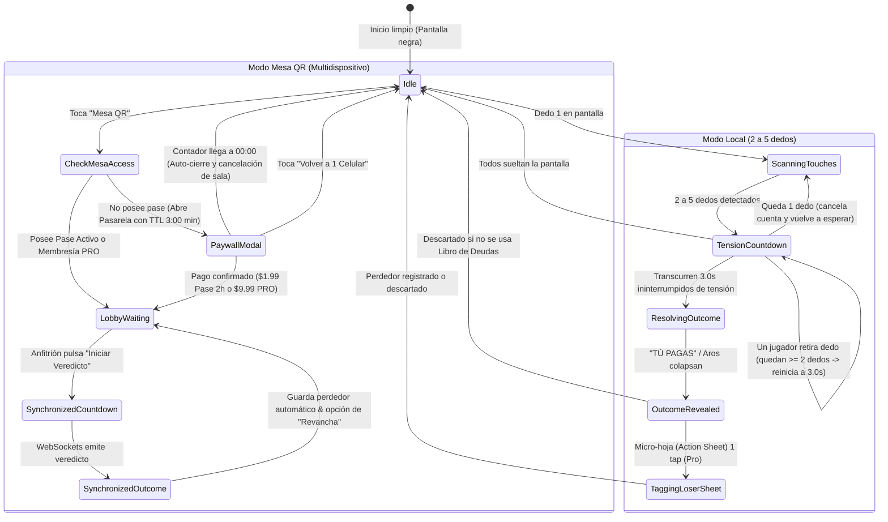

# 🗺️ Flujo de la Aplicación (App Flow) — WHO PAYS?

> **Documento:** 03 de 06 (Estándar Canónico de Planificación)
> **Producto:** WHO PAYS? (El Selector Social Táctil & Motor de Decisión P2P)
> **Ubicación:** `E:\development\business\mobile\social\who_pays\docs\03_APP_FLOW.md`
> **Autor:** Marco Antonio Huamani Bonifacio (UNI - Ciencia de la Computación)
> **Versión:** 1.0.0-STABLE

---

## 1. 📱 Diagrama de Estados Finitos (FSM)

---

## 2. 🚶‍♂️ User Journey Detallado

### Flujo 1: Salida Casual de Amigos (3 a 5 personas)

1. **Paso 1:** Marco saca su teléfono y abre WHO PAYS?. La pantalla es 100% negra con un texto sutil en gris grafito: _"Pon tu dedo"_.
2. **Paso 2:** Los 4 amigos apoyan un dedo sobre la pantalla. Aparecen 4 aros de titanio cepillado rodeando la yema de cada uno.
3. **Paso 3:** La app detecta 4 puntos firmes e inicia la cuenta de tensión: el teléfono vibra con un latido creciente y los aros oscilan.
4. **Paso 4:** A los 3 segundos exactos, un sonido seco reverbera, 3 aros se desvanecen en blanco perla y el aro de Pedro se ilumina en titanio oscuro con la frase: **"TÚ PAGAS"**. Risas inmediatas en la mesa.
5. **Paso 5 (Identificación del Perdedor en Modo Local):** Desde la parte inferior emerge con un rebote suave (Apple HIG) una micro-hoja (Action Sheet):
    - **Si es la primera vez que se usa la app:** Como no hay historial previo, aparece un campo de texto limpio con foco automático: `[ Escribe su nombre o apodo... ]` y sugerencias rápidas `[ Jugador 1 ]`, `[ Jugador 2 ]`. Pedro escribe _"Pedro"_ y presiona Enter o pulsa Guardar. A partir de este instante, Pedro queda registrado en el SQLite local y en todas las rondas futuras aparecerá como un chip de 1 tap.
    - **Si ya se usó antes:** Muestra directamente los chips de un solo toque: `[ Pedro ]` `[ Lucas ]` `[ Marco ]` `[ Renato ]`. Pedro solo toca su chip en 0.5 segundos.
    - Marco ingresa `S/ 48.00` opcionalmente y pulsa `[Guardar en Deudas]`. La deuda queda asentada en el grafo (`CC232`). Si no desean registrarla, basta con tocar fuera de la tarjeta para volver a jugar.

### Flujo 2: Mesa Grande en Restaurante (Multidispositivo)

1. **Paso 1:** Marco toca el botón superior **"Mesa QR"**.
2. **Paso 2 (Pasarela Previa con Timeout Estricto de 3 Minutos):** Al no tener pase activo, se despliega la **Pasarela de Pago (Paywall)** con el temporizador tabular **03:00**:
    - `03:00` a `01:30`: Verde Esmeralda (`#30D158`) — Tiempo suficiente.
    - `01:30` a `00:30`: Amarillo Ámbar (`#FFD60A`) — Atención moderada.
    - `00:30` a `00:00`: Rojo Carmesí (`#FF453A`) con pulsos acústicos en los últimos 10 segundos.
    - **Regla Inflexible de Expiración:** Si el contador llega a `00:00`, la pasarela se cierra automáticamente, revierte la selección a "1 Celular" y libera memoria.
    - Marco selecciona entre:
        - **Pase de Mesa (2 Horas):** `$1.99 USD` (~S/ 7.16).
        - **WHO PAYS? PRO:** `$9.99 USD/mes`.
3. **Paso 3 (Desbloqueo & Generación de Sala):** Marco pulsa pagar vía Lemon Cash / Yape / Tarjeta / Apple Pay. La app emite el tono de éxito (`playSuccessChime`), asienta el pase activo en `localStorage` y da paso inmediato a la pantalla de **Mesa QR** con el código de sala `SALA 7F2A`.
4. **Paso 4 (Conexión de Invitados):** Los demás comensales apuntan la cámara de su teléfono y entran a la PWA al instante.
5. **Paso 5:** Todos mantienen presionado su botón en su propio teléfono; las pantallas vibran al unísono.
6. **Paso 6:** Al resolverse, los teléfonos de los ganadores dicen _"A SALVO"_, y el perdedor recibe **"TÚ PAGAS"** con vibración intensa y registro automático en el Libro de Deudas.
