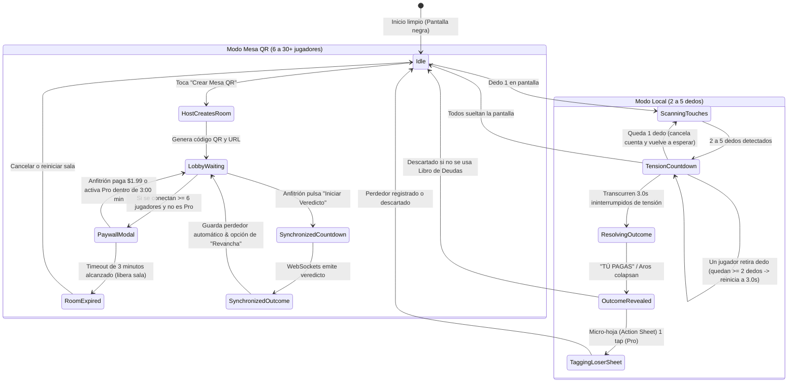

# 🗺️ Flujo de la Aplicación (App Flow) — WHO PAYS?

> **Documento:** 03 de 06 (Estándar Canónico de Planificación)
> **Producto:** WHO PAYS? (El Selector Social Táctil & Motor de Decisión P2P)
> **Ubicación:** `E:\development\business\mobile\social\who_pays\docs\03_APP_FLOW.md`
> **Autor:** Marco Antonio Huamani Bonifacio (UNI - Ciencia de la Computación)
> **Versión:** 1.0.0-STABLE

---

## 1. 📱 Diagrama de Estados Finitos (FSM)

---

## 2. 🚶‍♂️ User Journey Detallado

### Flujo 1: Salida Casual de Amigos (3 a 5 personas)

1. **Paso 1:** Marco saca su teléfono y abre WHO PAYS?. La pantalla es 100% negra con un texto sutil en gris grafito: _"Pon tu dedo"_.
2. **Paso 2:** Los 4 amigos apoyan un dedo sobre la pantalla. Aparecen 4 aros de titanio cepillado rodeando la yema de cada uno.
3. **Paso 3:** La app detecta 4 puntos firmes e inicia la cuenta de tensión: el teléfono vibra con un latido creciente y los aros oscilan.
4. **Paso 4:** A los 3 segundos exactos, un sonido seco reverbera, 3 aros se desvanecen en blanco perla y el aro de Pedro se ilumina en titanio oscuro con la frase: **"TÚ PAGAS"**. Risas inmediatas en la mesa.
5. **Paso 5 (Identificación del Perdedor en Modo Local):** Desde la parte inferior emerge con un rebote suave (Apple HIG) una micro-hoja (Action Sheet):
    - **Si es la primera vez que se usa la app:** Como no hay historial previo, aparece un campo de texto limpio con foco automático: `[ Escribe su nombre o apodo... ]` y sugerencias rápidas `[ Jugador 1 ]`, `[ Jugador 2 ]`. Pedro escribe _"Pedro"_ y presiona Enter o pulsa Guardar. A partir de este instante, Pedro queda registrado en el SQLite local y en todas las rondas futuras aparecerá como un chip de 1 tap.
    - **Si ya se usó antes:** Muestra directamente los chips de un solo toque: `[ Pedro ]` `[ Lucas ]` `[ Marco ]` `[ Renato ]`. Pedro solo toca su chip en 0.5 segundos.
    - Marco ingresa `S/ 48.00` opcionalmente y pulsa `[Guardar en Deudas]`. La deuda queda asentada en el grafo (`CC232`). Si no desean registrarla, basta con tocar fuera de la tarjeta para volver a jugar.

### Flujo 2: Mesa Grande en Restaurante (10 personas)

1. **Paso 1:** Marco toca el botón sutil _"Mesa QR"_. La pantalla muestra un código QR elegante.
2. **Paso 2 (Identificación Automática en Modo QR):** Los otros 9 comensales apuntan la cámara de su teléfono y entran a `whopays.app/m/7F2A` en Safari/Chrome al instante. Cada uno introduce su nombre (ej. "Carlos", "Lucía") en un campo de 1 línea antes de entrar a la sala.
3. **Paso 3 (Ventana de Pago con Timeout de 3 Minutos & Color Dinámico):** Como son 10 personas, a Marco (el anfitrión) le aparece el modal de activación con un reloj regresivo **03:00** que muta de color según la urgencia:
    - `03:00` a `01:30`: Verde Esmeralda (`#30D158`) — Tiempo suficiente.
    - `01:30` a `00:30`: Amarillo Ámbar (`#FFD60A`) — Atención.
    - `00:30` a `00:00`: Rojo Carmesí (`#FF453A`) — Expiración inminente.
    - Opción A: **Ticket de Mesa Única ($1.99 USD)** vía Lemon Squeezy / Apple Pay / Yape.
    - Opción B: **Suscripción Pro Mensual ($9.99 USD/mes)**.
    - _Regla de expiración:_ Marco tiene hasta 3 minutos para confirmar el pago. Si no lo hace, la orden caduca, la sala se cancela y se liberan las conexiones en el servidor (`CC222`).
4. **Paso 4:** Marco paga $1.99 con Apple Pay / Yape en 3 segundos. El webhook firmado con HMAC-SHA256 valida la orden y activa la sala al instante.
5. **Paso 5:** Los 10 jugadores mantienen presionado su botón en su propio teléfono. Las 10 pantallas empiezan a vibrar sincronizadas.
6. **Paso 6:** Al llegar a cero, 9 teléfonos vibran suave y dicen _"A SALVO"_. El teléfono de Carlos vibra intensamente con un golpe seco y dice: _"TÚ PAGAS"_.
7. **Paso 7 (Asentamiento Automático):** Como Carlos ingresó su nombre en el Paso 2, el WebSocket registra a "Carlos" directamente en el Libro de Deudas del anfitrión como el perdedor oficial de la ronda.
